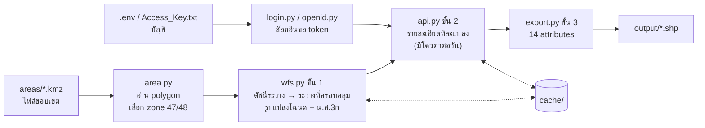

# LandsMaps Parcels — ดึงแปลงที่ดินตามขอบเขตพื้นที่

วางไฟล์ขอบเขตพื้นที่ (KMZ / KML / SHP / GPKG / GeoJSON / GDB) แล้วรันคำสั่งเดียว
ได้ **Shapefile แปลงโฉนดและ น.ส.3ก ทุกแปลงในพื้นที่** จาก [LandsMaps กรมที่ดิน](https://landsmaps.dol.go.th/)
พร้อมเลขที่ดิน ระวาง ประเภท ไร่-งาน-วา และภาระผูกพัน เปิดใน QGIS / ArcGIS ได้ทันที

```
areas/my_site.kmz  ──►  python fetch_parcels.py  ──►  output/my_site/my_site_parcel_epsg24047.shp
                                                       output/my_site/my_site_ns3k_epsg24047.shp
```

- ใช้ได้ทั้งประเทศ (UTM zone 47 และ 48 ตรวจให้อัตโนมัติ)
- ไม่ต้องแก้ code ไม่ต้องรู้เลขระวาง
- หยุดกลางทางแล้วรันใหม่ได้ จะทำต่อจากที่ค้างไว้
- กรอกบัญชี LandsMaps ไว้ครั้งเดียว โปรแกรมล็อกอินขอ token ใหม่ให้เองทุกครั้งที่รัน (รองรับบัญชีทางรัฐ / DGA)

---

## Workspace

```
LandParcels/
│
├── areas/                  ◄── ① วางไฟล์ขอบเขตพื้นที่ของคุณที่นี่
│   └── my_site.kmz             (ชื่อไฟล์ = ชื่อโฟลเดอร์/ไฟล์ผลลัพธ์)
│
├── fetch_parcels.py        ◄── ② รันไฟล์นี้: ดึงแปลงทุกพื้นที่ใน areas/ (ล็อกอินให้เองถ้ามีบัญชี)
├── get_token.py                ล็อกอินขอ access token แล้วเขียนลง Access_Key.txt
├── search_parcel.py            (เสริม) ค้นแปลงจากเลขโฉนด
├── Program_fetch_parcel.cmd    (Windows) ดับเบิลคลิกเพื่อรัน fetch_parcels.py ด้วย Python ที่กำหนด
│
├── .env.example                ตัวอย่างไฟล์บัญชี -> คัดลอกเป็น .env
├── .env                        (ไม่บังคับ) บัญชี LandsMaps สำหรับล็อกอินอัตโนมัติ — ห้ามแชร์
├── Access_Key.txt              (ไม่บังคับ) บัญชี + access token (JSON) — ห้ามแชร์
│
├── output/                 ◄── ③ ผลลัพธ์ (สร้างให้อัตโนมัติ)
│   ├── my_site/
│   │   ├── my_site_parcel_epsg24047.shp    โฉนดที่ดิน
│   │   └── my_site_ns3k_epsg24047.shp      น.ส.3ก
│   └── search/
│       └── parcel_search_epsg24047.shp     ผลจาก search_parcel.py
│
├── cache/                      ข้อมูลดิบที่ดึงมาแล้ว (ทำให้รันซ้ำ/ทำต่อได้ ไม่ต้องดึงใหม่)
│   ├── my_site_detail.jsonl        รายละเอียดรายแปลง — อย่าลบ ใช้โควตาไปแล้ว
│   └── parcel_53394_my_site.json   รูปแปลงจาก WFS — ลบได้ ดึงใหม่ฟรี
│
├── landsmaps/                  ตัว code (ไม่ต้องแก้)
│   ├── config.py                   ค่าตั้งต้น: โฟลเดอร์, URL, หน่วงเวลา, ชื่อ field, ฟอร์ม DGA
│   ├── area.py                     อ่านไฟล์ขอบเขต -> polygon + เลือก zone
│   ├── zones.py                    zone 47/48: ชื่อ layer, EPSG, การแปลงพิกัด
│   ├── wfs.py                      ขั้น 1: หาระวาง + รูปแปลงจาก WFS
│   ├── api.py                      ขั้น 2: รายละเอียดรายแปลง + ตรวจ token + cache
│   ├── export.py                   ขั้น 3: จัด 14 attributes -> Shapefile
│   ├── pipeline.py                 รวม 3 ขั้นสำหรับ 1 พื้นที่
│   ├── login.py                    หาบัญชี DGA (env / .env / Access_Key.txt) แล้วล็อกอินขอ token
│   ├── openid.py                   ล็อกอินผ่าน DGA (บัญชีทางรัฐ)
│   └── keystore.py                 อ่าน/เขียน Access_Key.txt + จำกัดสิทธิ์ไฟล์
│
├── notebook/fetch_parcels.ipynb    ทางเลือกสำหรับคนที่ใช้ Jupyter
├── examples/sample_area.geojson    พื้นที่ตัวอย่างเล็ก ๆ ไว้ลองรัน
├── tests/                          ชุดทดสอบ (pytest, offline ทั้งหมด)
└── requirements.txt
```

`areas/`, `output/`, `cache/`, `.env` และ `Access_Key.txt` อยู่ใน `.gitignore` แล้ว ข้อมูลพื้นที่ บัญชี และ token ของคุณจะไม่ถูก commit ขึ้น git

---

## เริ่มใช้งาน

### 1. ดาวน์โหลดโปรเจกต์ (clone)

ต้องติดตั้ง [Git](https://git-scm.com/downloads) ก่อน แล้วเปิดโปรแกรม shell สำหรับพิมพ์คำสั่ง:

| ระบบ | โปรแกรม shell ที่ใช้ |
|---|---|
| Windows | **PowerShell** (กด Start พิมพ์ `PowerShell`) หรือ **Git Bash** (ติดตั้งมาพร้อม Git for Windows) หรือ Terminal ใน VS Code (`` Ctrl+` ``) |
| macOS / Linux | **Terminal** |

พิมพ์คำสั่งต่อไปนี้ทีละบรรทัด:

```bash
cd D:\Projects                                        # ไปยังโฟลเดอร์ที่จะเก็บโปรเจกต์ (macOS/Linux เช่น cd ~/Projects)
git clone https://github.com/ParqeJ/LandParcels.git   # ดาวน์โหลดโปรเจกต์
cd LandParcels                                        # เข้าไปในโฟลเดอร์โปรเจกต์
```

คำสั่งในขั้นถัด ๆ ไปทั้งหมด ให้รันใน shell เดียวกันนี้ ขณะอยู่ในโฟลเดอร์ `LandParcels`

- **ไม่มี Git?** เปิด https://github.com/ParqeJ/LandParcels กดปุ่ม **Code → Download ZIP** แล้วแตกไฟล์ จากนั้น `cd` เข้าโฟลเดอร์ที่แตกออกมา
- **อัปเดตเป็นเวอร์ชันล่าสุด** ภายหลัง: รัน `git pull` ในโฟลเดอร์ `LandParcels` (ไฟล์ใน `areas/` `output/` `cache/` `.env` `Access_Key.txt` จะไม่ถูกแตะ)

### 2. ติดตั้ง (ครั้งเดียว)

ต้องมี Python 3.10 ขึ้นไป

```bash
pip install -r requirements.txt
```

> ถ้าใช้ Anaconda: `conda install -c conda-forge geopandas pyogrio requests` ก็พอ
>
> Windows: ถ้าพิมพ์ `python` / `pip` แล้วไม่เจอคำสั่ง ให้ใช้ `py` และ `py -m pip` แทน

### 3. (แนะนำ) กรอกบัญชีทางรัฐ (DGA)

ไม่บังคับ แต่ถ้ามีบัญชีจะดึงรายละเอียดได้มากขึ้นราว 10 เท่า ([ดูโควตา](#โควตาและ-access-token))

1. คัดลอก `.env.example` เป็น `.env` ที่โฟลเดอร์หลัก
2. เปิด `.env` แล้วกรอกบัญชีทางรัฐ (บัญชีเดียวกับปุ่ม "เข้าสู่ระบบด้วย DGA" ในเว็บ) กับรหัสผ่าน

   ```ini
   LANDSMAPS_DGA_ID=1234567890123
   LANDSMAPS_PASSWORD=your-password
   ```

3. ทดสอบล็อกอิน: `python get_token.py` ถ้าสำเร็จจะเห็น `ล็อกอินสำเร็จ (...) -> เขียน Access_Key.txt แล้ว (หมดอายุ ...)`

รายละเอียดทั้งหมดอยู่ที่ [ล็อกอินอัตโนมัติ](#ล็อกอินอัตโนมัติ-แนะนำ)

### 4. วางไฟล์ขอบเขต

คัดลอกไฟล์พื้นที่ไปไว้ใน `areas/` วางได้หลายไฟล์ ไฟล์ละพื้นที่

| รูปแบบ | หมายเหตุ |
|---|---|
| `.kmz` / `.kml` | วาดจาก Google Earth / My Maps ได้เลย |
| `.shp` | ต้องมี `.shx` `.dbf` `.prj` อยู่ด้วย |
| `.gpkg`, `.geojson`, `.json` | |
| โฟลเดอร์ `.gdb` | File Geodatabase ของ ArcGIS |

- ต้องเป็น **รูปปิด (polygon)** ถ้ามีจุด/เส้นปนมาจะข้ามให้เอง ถ้ามีหลาย polygon (หรือหลาย layer) จะรวมเป็นพื้นที่เดียว
- พิกัดระบบไหนก็ได้ ถ้ามีข้อมูล CRS (`.prj`) จะแปลงให้เอง ถ้าไม่มี CRS แต่พิกัดอยู่ในช่วง lon/lat จะถือว่าเป็น EPSG:4326
- ชื่อไฟล์จะใช้เป็นชื่อผลลัพธ์ เช่น `Site A.kmz` → `output/site_a/` (ไฟล์ที่ชื่อขึ้นต้นด้วย `.` จะถูกข้าม)

### 5. รัน

```bash
python fetch_parcels.py
```

Windows: ดับเบิลคลิก `Program_fetch_parcel.cmd` ก็ได้ ([ดูหมายเหตุ](#program_fetch_parcelcmd-windows))

ตัวอย่างผลที่จอ (กรณีไม่ได้กรอกบัญชี):

```
LandsMaps: ไม่ล็อกอิน (ค้นรายละเอียดได้ประมาณ 20-40 แปลง/วัน)
[sample_area] 0.43 ตร.กม.  zone 48  bbox (104.8, 15.2, 104.806, 15.206)
  ระวาง: 59392
  parcel ระวาง 59392: 75 แปลงใน bbox
  parcel: 73 แปลงแตะกรอบ (ครอบคลุม 65% ของพื้นที่)
  ns3k ระวาง 5939: 0 แปลงใน bbox
  ns3k: 0 แปลงแตะกรอบ (ครอบคลุม 0% ของพื้นที่)
  LandsMaps: ไม่ล็อกอิน (ค้นรายละเอียดได้ประมาณ 20-40 แปลง/วัน)
  รายละเอียด: มี cache 0 แปลง  เหลือ 73 แปลง
  หยุด: LandsMaps แจ้ง [เกินจำกัด 20 /วัน ...] -> ดึงได้ 31 แปลงในรอบนี้ ...
  -> output/sample_area/sample_area_parcel_epsg24048.shp: 73 แปลง (ยังไม่มีรายละเอียด 42)
  -> sample_area_ns3k_epsg24048.shp: ไม่มีแปลง (ไม่สร้างไฟล์)
```

ถ้ากรอกบัญชีไว้ บรรทัดแรกจะเป็น `ล็อกอิน LandsMaps สำเร็จ (...)` ตามด้วยเวลาหมดอายุของ token

ถ้ายังไม่มีไฟล์ของตัวเอง ลองกับพื้นที่ตัวอย่างก่อนได้ (`--no-detail` = ไม่ล็อกอิน ไม่ใช้โควตา):

```bash
python fetch_parcels.py examples/sample_area.geojson --no-detail
```

### 6. เปิดใน QGIS

ลาก `.shp` จาก `output/` เข้า QGIS ได้เลย ผลลัพธ์ใช้ CRS ดั้งเดิมของกรมที่ดิน

| พื้นที่ | CRS |
|---|---|
| ตะวันตกของ 102°E (ส่วนใหญ่ของประเทศ) | EPSG:24047 Indian 1975 / UTM 47N |
| ตั้งแต่ 102°E ไปทางตะวันออก (อีสานตะวันออก ตะวันออกบางส่วน) | EPSG:24048 Indian 1975 / UTM 48N |

ตั้ง Project CRS ให้ตรงกับไฟล์ แล้วแปลงจะซ้อนกับ WMS ของกรมที่ดินได้ตรง

---

## ตัวเลือกคำสั่ง

### `fetch_parcels.py` — ดึงแปลงตามขอบเขต

```bash
python fetch_parcels.py                            # ทุกไฟล์ใน areas/
python fetch_parcels.py areas/a.kmz areas/b.shp    # เฉพาะไฟล์ที่ระบุ (อยู่ที่ไหนก็ได้)
python fetch_parcels.py --no-detail                # แค่รูปแปลง + เลขที่ดิน ไม่ล็อกอิน ไม่ใช้โควตา
python fetch_parcels.py site.gdb --layer Polygons  # เลือก layer (ไม่ระบุ = รวม polygon ทุก layer)
python fetch_parcels.py "พื้นที่ใหม่.kmz" --name site2   # ตั้งชื่อผลลัพธ์เอง (ใช้ได้เมื่อระบุไฟล์เดียว)
```

- ถ้าพื้นที่หนึ่งผิดพลาด พื้นที่อื่นยังทำต่อ แล้วสรุปท้ายว่า `ไม่สำเร็จ N พื้นที่: ...` (exit code 1)
- ถ้าโควตาเต็มระหว่างทาง พื้นที่ถัดไปจะดึงแค่รูปแปลง (ไม่เสียเวลาลองต่อ)

### `get_token.py` — ล็อกอินขอ access token

```bash
python get_token.py                 # ล็อกอินใหม่ด้วยบัญชีที่บันทึกไว้ แล้วเขียน Access_Key.txt + .env
python get_token.py --where         # ดูว่าเก็บบัญชี/token ไว้ที่ไหน มีอะไรบ้าง (ไม่โชว์รหัสผ่าน/token เต็ม)
```

### `search_parcel.py` — ค้นจากเลขโฉนด

```bash
python search_parcel.py --prov 36 --amphur 07 30219 30220
```

- `--prov` = รหัสจังหวัด 2 หลัก, `--amphur` = รหัสอำเภอ 2 หลัก (ดูได้จากหน้าค้นหาแปลงในเว็บ LandsMaps) เลขโฉนดใส่ได้หลายเลข ต้องเป็นเลขอารบิก 0-9 (เลขไทย ๑๒๓ ใช้ไม่ได้)
- ผลลัพธ์อยู่ที่ `output/search/parcel_search_epsg240xx.shp` (แยกไฟล์ตาม zone ถ้าปนกัน) วิธีนี้ได้ **เลขโฉนดเต็ม** (ค้นจากตำแหน่งจะได้แบบซ่อน `xxxx19`)
- คำสั่งนี้**ไม่ล็อกอินเอง** ใช้ token ที่มีอยู่ใน `Access_Key.txt` → รัน `python get_token.py` ก่อนถ้า token อาจหมดอายุแล้ว

### Jupyter

เปิด `notebook/fetch_parcels.ipynb` แก้ `AREA_FILE` (หรือปล่อย `None` = ทุกไฟล์ใน `areas/`) และ `FETCH_DETAIL` แล้ว Run All

notebook **ไม่ล็อกอินเอง** เหมือน `search_parcel.py` → รัน `python get_token.py` ก่อนเปิด notebook

### `Program_fetch_parcel.cmd` (Windows)

ไฟล์นี้รัน `fetch_parcels.py` (ซึ่งล็อกอินขอ token ให้เองแล้ว) ด้วย Python ที่กำหนดไว้ในบรรทัด `set "PY=..."`
กันไม่ให้ไปเรียก Python ตัวอื่นที่ไม่มี geopandas ค่าเริ่มต้นคือ `C:\Users\User\anaconda3\envs\satellite\python.exe`

- เครื่องอื่นติดตั้ง Python ไว้ที่อื่น → เปิดไฟล์ด้วย Notepad แล้วแก้บรรทัด `set "PY=..."` บรรทัดเดียว
- ถ้าหา Python ที่กำหนดไม่เจอ จะขึ้น `Python not found` แล้วหยุด (ไม่ไปใช้ Python ตัวอื่นแทน)
- รันในโฟลเดอร์ของไฟล์ `.cmd` เสมอ เปิดจาก shortcut หรือจากโฟลเดอร์อื่นก็ได้

---

## โควตาและ Access Token

LandsMaps จำกัดจำนวน **การค้นรายละเอียดแปลงต่อวัน** (รูปแปลงจาก WFS ไม่จำกัด ไม่ต้องล็อกอิน)

| แบบ | ค้นรายละเอียดได้ต่อวัน (โดยประมาณ) |
|---|---|
| ไม่ล็อกอิน | ~20 – 40 แปลง |
| ล็อกอิน (ใช้ access token ของบัญชี) | ~200 – 400 แปลง |

> ตัวเลขนี้มาจากการใช้งานจริง ไม่ใช่ตัวเลขทางการ เว็บจะแจ้งว่า "เกินจำกัด 20 /วัน หรือ 200 /วัน เมื่อทำการล็อกอิน" แต่จำนวนที่ดึงได้จริงมักมากกว่านั้นและไม่เท่ากันทุกวัน กรมที่ดินอาจเปลี่ยนเงื่อนไขได้ทุกเมื่อ

เมื่อโควตาเต็ม โปรแกรมจะหยุดเองแล้วบันทึก Shapefile ให้ (แปลงที่ยังไม่ได้ดึงมี Remark = `ยังไม่ได้ดึงรายละเอียด`) รันซ้ำวันถัดไปจะทำต่อจาก cache

access token ของบัญชีมีอายุ **24 ชั่วโมง** ได้มา 2 วิธี:

### ล็อกอินอัตโนมัติ (แนะนำ)

กรอกบัญชีไว้ครั้งเดียว แล้ว `fetch_parcels.py` จะ**ล็อกอินใหม่ทุกครั้งที่รัน** (ไม่เช็กว่าของเดิมหมดอายุหรือยัง) และเขียน token ใหม่ลง `Access_Key.txt`

รองรับเฉพาะ**บัญชีทางรัฐ (DGA)** — ปุ่ม "เข้าสู่ระบบด้วย DGA" ในเว็บ ใส่ 2 ค่าใน `.env`:

| ตัวแปรใน `.env` | ค่า |
|---|---|
| `LANDSMAPS_DGA_ID` | เลขประจำตัวประชาชน / ชื่อผู้ใช้ / อีเมล ที่ใช้ล็อกอินบัญชีทางรัฐ |
| `LANDSMAPS_PASSWORD` | รหัสผ่านบัญชีทางรัฐ |

รหัสผ่านที่มี `#` ติดกัน (เช่น `abc#123`) ใส่ได้เลย ถ้ามีช่องว่าง ช่องว่างตามด้วย `#` หรือเครื่องหมายคำพูด ให้ครอบด้วย `' '` เช่น `LANDSMAPS_PASSWORD='abc #123'` (ตอนโปรแกรมเขียน `.env` ให้เองจะครอบให้อัตโนมัติ)

> ล็อกอินด้วยอีเมล / เลขประจำตัวประชาชนของกรมที่ดิน / บัญชีเจ้าหน้าที่ (AD) ถูกถอดออกแล้ว ถ้าใช้บัญชีแบบนั้น ให้[คัดลอก token เองจาก browser](#คัดลอก-token-เองจาก-browser)

#### บัญชีเก็บได้ 3 ที่

โปรแกรมหาบัญชีตามลำดับนี้:

1. **environment variable** (`LANDSMAPS_DGA_ID`, `LANDSMAPS_PASSWORD`) — ทับค่าใน `.env`
2. **ไฟล์ `.env`** ที่โฟลเดอร์หลัก (รูปแบบ `KEY=value` บรรทัดละตัว `#` = คอมเมนต์)
3. **ไฟล์ `Access_Key.txt`** — ใช้เมื่อข้อ 1-2 ไม่มีชื่อบัญชีเลย เป็นไฟล์เดียวกับที่เก็บ token เปิดด้วย Notepad แก้ได้

   ```json
   {
     "kind": "openid",
     "user": "1234567890123",
     "pass": "your-password",
     "key": "eyJhbGciOiJIUzUxMiIs...",
     "saved_at": "2026-10-25T23:10:04"
   }
   ```

   `kind` ต้องเป็น `openid` (หรือไม่ใส่ก็ได้) ไฟล์แบบเก่า (token เปล่าบรรทัดเดียว) ยังอ่านได้ ไม่ต้องแปลงมือ
   ถ้าแก้ไฟล์แล้ว JSON เสีย โปรแกรมจะหยุดและแจ้งให้แก้ (ไม่เดาว่าทั้งไฟล์คือ token)

ทุกครั้งที่ล็อกอินสำเร็จ โปรแกรมเขียนบัญชีและ token ลง**ทั้ง** `Access_Key.txt` และ `.env` (บรรทัดเดิมถูกแทนที่ บรรทัดอื่นไม่ถูกแตะ) และจำกัดสิทธิ์ไฟล์ทั้งสองให้อ่านได้เฉพาะผู้ใช้เจ้าของ (`icacls` บน Windows / `chmod 600` บน macOS/Linux)

#### ถ้าล็อกอินไม่ผ่าน

| สถานการณ์ | `fetch_parcels.py` ทำอะไร |
|---|---|
| ไม่ได้กรอกบัญชีไว้ | ใช้ token เดิมใน `Access_Key.txt` (ถ้ามี) ไม่มี = ใช้แบบไม่ล็อกอิน |
| ล็อกอินไม่ผ่าน (บัญชีผิด เน็ตล่ม หรือ DGA/LandsMaps ตอบ 5xx) แต่มี token เดิมอยู่ | เตือน `ล็อกอินอัตโนมัติไม่สำเร็จ` แล้วใช้ token เดิมต่อ (ได้ถ้าล็อกอินครั้งก่อนไม่เกิน 24 ชม.) |
| ล็อกอินไม่ผ่าน และไม่มี token เดิม | หยุดก่อนเริ่ม แนะนำให้ใช้ `--no-detail` |
| token ที่จะใช้หมดอายุแล้ว | หยุดก่อนเริ่ม แจ้งให้รัน `python get_token.py` |

> บัญชี DGA ต้อง**พิสูจน์ตัวตนกับ OpenID แล้ว** และ**ปิด OTP (ยืนยัน 2 ขั้น)** ไว้ ไม่งั้นล็อกอินอัตโนมัติไม่ผ่าน (โปรแกรมจะบอกสาเหตุให้)

> ความปลอดภัย: ระหว่างล็อกอิน DGA โปรแกรมเดินตาม redirect เอง และยอมส่งข้อมูลเฉพาะ https ไปที่ `connect.egov.go.th` กับ `landsmaps.dol.go.th` เท่านั้น ถ้าถูกส่งต่อไปโฮสต์อื่นจะหยุดทันที

### คัดลอก token เองจาก browser

ใช้เมื่อไม่อยากเก็บรหัสผ่านไว้ในเครื่อง บัญชีเปิด OTP อยู่ หรือใช้บัญชีที่ไม่ใช่ DGA

1. ล็อกอิน https://landsmaps.dol.go.th/ ด้วย Chrome/Edge
2. กด `F12` → แท็บ **Application** → **Session Storage** → `https://landsmaps.dol.go.th` → `userinfo`
3. คัดลอกค่า `access_token`
4. วางลงไฟล์ `Access_Key.txt` ที่โฟลเดอร์หลัก (token เปล่าบรรทัดเดียวก็ได้ หรือใส่ในช่อง `"key"` ของ JSON) หรือตั้ง environment variable `LANDSMAPS_TOKEN`

ต้องคัดลอกใหม่ทุก 24 ชม. ถ้าตั้ง `LANDSMAPS_TOKEN` ไว้ ค่านี้จะถูกใช้ก่อน token ใน `Access_Key.txt` เสมอ (รวมถึง token ที่เพิ่งล็อกอินได้) — ถ้าใช้ล็อกอินอัตโนมัติ อย่าตั้งตัวแปรนี้

> ⚠️ `.env` และ `Access_Key.txt` มีรหัสผ่านบัญชีจริง และ token มีข้อมูลบัญชีกับเลขประจำตัวของคุณอยู่ข้างใน **ห้ามแชร์ ส่งต่อ หรือ commit ขึ้น git** (ทั้งสองไฟล์อยู่ใน `.gitignore` แล้ว)

---

## ข้อมูลในไฟล์ผลลัพธ์

| Field | ความหมาย | ที่มา |
|---|---|---|
| `Owner_Name` | ชื่อเจ้าของ | เว้นว่าง — LandsMaps ไม่เปิดเผย |
| `Surname` | นามสกุล | เว้นว่าง — LandsMaps ไม่เปิดเผย |
| `Contact_No` | เบอร์ติดต่อ | เว้นว่าง — LandsMaps ไม่เปิดเผย |
| `Type_land` | ประเภทเอกสารสิทธิ์ (โฉนดที่ดิน / น.ส.3ก) | API |
| `Rawang` | ระวาง เช่น `5339 IV 7808-00` | API |
| `Group` | กลุ่ม | เว้นว่างไว้ให้กรอกเอง |
| `Plang` | เลขที่ดิน | WFS |
| `Cert_No` | เลขโฉนด (ค้นจากตำแหน่งจะเห็น 2 หลักท้าย เช่น `xxxx19` / `search_parcel.py` ได้เลขเต็ม) | API |
| `Rai` `Ngan` `Wa` | เนื้อที่ตามเอกสารสิทธิ์ (`Wa` รวมเศษวาเป็นทศนิยมแล้ว) | API |
| `Status` | ภาระผูกพัน เช่น `obligation:จำนอง` | API |
| `LLA_no` | | เว้นว่างไว้ให้กรอกเอง |
| `Remark` | ว่าง = ครบ / `ยังไม่ได้ดึงรายละเอียด` / `ไม่พบรายละเอียดใน LandsMaps` / `ตำแหน่งชี้ไปแปลงอื่น` | |

ไฟล์ `*_ns3k_*` (น.ส.3ก) มีแค่รูปแปลงและเลขที่ดิน เพราะ LandsMaps ไม่มี API รายละเอียดของ น.ส.3ก จากตำแหน่ง

ถ้าพื้นที่ไม่มีแปลงเลย จะไม่สร้าง Shapefile (และลบไฟล์ผลเก่าของรอบก่อนทิ้ง ไม่ให้เข้าใจผิดว่าเป็นผลล่าสุด)

ถ้าต้องการเปลี่ยนชื่อ/ลำดับ field แก้ `FIELDS` ใน [landsmaps/config.py](landsmaps/config.py) (Shapefile จำกัดชื่อ field ไม่เกิน 10 ตัวอักษร)

---

## ทำงานอย่างไร



0. **ล็อกอิน** (ถ้ามีบัญชีและไม่ได้ใช้ `--no-detail`) ขอ access token ใหม่ผ่าน DGA แล้วตรวจวันหมดอายุก่อนเริ่ม
1. **อ่านขอบเขต** รวม polygon ทั้งหมดในไฟล์ แปลงพิกัดด้วยสูตรเดียวกับที่ GeoServer ของกรมที่ดินใช้ (Indian 1975 → WGS84) แปลงจึงซ้อนตรง
2. **รูปแปลง (WFS)** หาระวาง 1:50,000 ที่ครอบคลุมจากดัชนีระวาง แล้วดึงรูปแปลงเฉพาะใน bbox คัดเฉพาะแปลงที่แตะขอบเขต ตัดแปลงซ้ำที่คร่อมระวาง ขั้นนี้ไม่จำกัดจำนวน ไม่ต้องล็อกอิน
3. **รายละเอียด (API)** ถามข้อมูลที่จุดภายในแปลงทีละแปลง หน่วง 1 วินาที/แปลงเพื่อไม่ให้โหลดเซิร์ฟเวอร์กรมที่ดิน ถ้าเน็ตหลุดจะลองซ้ำ (รอ 5, 15, 45 วินาที) บันทึกลง `cache/<ชื่อ>_detail.jsonl` ทันทีทุกแปลง
4. **Shapefile** รวมรูปแปลง + รายละเอียด ตามลำดับ field ที่กำหนด (UTF-8 มีไฟล์ `.cpg`)

---

## ข้อจำกัด

- ข้อมูลเจ้าของ (ชื่อ นามสกุล เบอร์) **ไม่มี** ใน LandsMaps แบบสาธารณะ
- ที่ดินที่ไม่อยู่ในระบบกรมที่ดิน (ส.ป.ก., ป่าสงวน, ที่สาธารณะ ฯลฯ) จะไม่มีแปลง ตัวเลข "ครอบคลุม xx% ของพื้นที่" ช่วยบอกว่าเหลือช่องว่างเท่าไร
- พื้นที่คร่อมเส้น 102°E จะใช้ zone ของจุดศูนย์กลาง ส่วนที่อยู่อีก zone จะหายไป → แยกเป็น 2 ไฟล์ (โปรแกรมจะเตือน)
- WFS ให้ได้สูงสุด 60,000 แปลงต่อระวางต่อครั้ง ถ้าเกินโปรแกรมจะแจ้ง → แบ่งพื้นที่ให้เล็กลง
- ไฟล์ KMZ อ่านเฉพาะไฟล์ `.kml` ตัวแรกที่อยู่ข้างใน
- ล็อกอินอัตโนมัติรองรับเฉพาะบัญชี DGA ที่ปิด OTP → บัญชีอื่นใช้วิธีคัดลอก token เอง
- เนื้อที่จากรูปแปลงเป็นค่าประมาณ ให้ใช้ ไร่-งาน-วา ตามเอกสารสิทธิ์เป็นหลัก
- ระบบ LandsMaps / DGA อาจเปลี่ยน API หรือหน้าล็อกอินได้โดยไม่แจ้ง (ชื่อช่องฟอร์ม DGA อยู่ที่ `DGA_*` ใน [landsmaps/config.py](landsmaps/config.py))

---

## Cache และการรันซ้ำ

| ไฟล์ | เก็บอะไร | ลบได้ไหม |
|---|---|---|
| `cache/<ชื่อ>_detail.jsonl` | รายละเอียดรายแปลงที่ดึงแล้ว (รวมแปลงที่ค้นแล้วไม่พบ) | **ไม่ควร** — ใช้โควตาไปแล้ว ลบแล้วต้องดึงใหม่ |
| `cache/parcel_<ระวาง>_<ชื่อ>.json`<br/>`cache/ns3k_<ระวาง>_<ชื่อ>.json` | รูปแปลงจาก WFS | ได้ — ดึงใหม่ฟรี (ถ้าแก้ขอบเขต ระบบจะดึงใหม่ให้เอง) |
| `output/` | Shapefile ผลลัพธ์ | ได้ — รันใหม่จะสร้างจาก cache ทันที |

- cache ผูกกับ **ชื่อพื้นที่** (ชื่อไฟล์ขอบเขต) ถ้าเปลี่ยนชื่อไฟล์ จะเริ่มนับรายละเอียดใหม่ (ใช้ `--name ชื่อเดิม` เพื่อใช้ cache เดิม)
- ถ้าโปรแกรมถูกหยุดกลางทางจนบรรทัดสุดท้ายของ `.jsonl` เขียนไม่จบ รอบถัดไปจะข้ามบรรทัดนั้นและดึงแปลงนั้นใหม่ให้เอง

---

## แก้ปัญหา

| อาการ | สาเหตุ / วิธีแก้ |
|---|---|
| `ไม่พบไฟล์ขอบเขต` | ยังไม่ได้วางไฟล์ใน `areas/` หรือนามสกุลไม่รองรับ |
| `ไม่พบ polygon` | ไฟล์มีแต่จุด/เส้น ต้องวาดเป็นรูปปิด |
| `ไม่พบไฟล์ .kml ใน KMZ` | ไฟล์ KMZ เสีย หรือไม่ใช่ KMZ จริง → export ใหม่จาก Google Earth |
| `ไม่มีข้อมูล CRS ... และพิกัดไม่ใช่ lon/lat` | Shapefile ขาด `.prj` → กำหนด CRS ใน QGIS แล้ว export ใหม่ |
| `ไม่พบระวางในกรอบนี้` | พื้นที่อยู่นอกประเทศไทย หรือพิกัดผิด (lat/lon สลับกัน) |
| `ข้อมูลถูกตัดที่ MAX_COUNT` | พื้นที่ใหญ่เกิน → แบ่งไฟล์ขอบเขตให้เล็กลง |
| `access token หมดอายุแล้ว` | token อายุ 24 ชม. → `python get_token.py` เพื่อล็อกอินใหม่ (หรือคัดลอกใหม่จาก browser / ลบ `Access_Key.txt` เพื่อใช้แบบไม่ล็อกอิน) |
| `access token ถูกปฏิเสธ (401)` | LandsMaps ไม่รับ token นี้แล้ว → `python get_token.py` |
| `เกินจำกัด 20 /วัน` | โควตาวันนี้หมด (ตัวเลขในข้อความไม่ตรงกับที่ดึงได้จริง ดู [โควตา](#โควตาและ-access-token)) → รันใหม่พรุ่งนี้ หรือใช้ token ของบัญชี |
| `ไม่พบบัญชีใน .env หรือ Access_Key.txt` | ยังไม่ได้กรอกบัญชี → ดู [ล็อกอินอัตโนมัติ](#ล็อกอินอัตโนมัติ-แนะนำ) |
| `ไม่พบรหัสผ่าน` | ใส่ชื่อบัญชีแล้วแต่ไม่มี `LANDSMAPS_PASSWORD` (หรือ `"pass"` ใน `Access_Key.txt`) |
| `Access_Key.txt ไม่ใช่ JSON ที่ถูกต้อง` | แก้ไฟล์แล้ววงเล็บ/เครื่องหมายคำพูดหาย → แก้ให้ถูก หรือลบไฟล์แล้วรัน `python get_token.py` ใหม่ |
| `บัญชีหรือรหัสผ่าน DGA ไม่ถูกต้อง` | ตรวจ `LANDSMAPS_DGA_ID` / `LANDSMAPS_PASSWORD` (ลองล็อกอินในเว็บด้วยค่าเดียวกัน) |
| `บัญชี DGA นี้เปิดยืนยัน 2 ขั้น (OTP)` | ปิด OTP ในบัญชีทางรัฐ หรือคัดลอก token เองจาก browser |
| `ล็อกอินอัตโนมัติไม่สำเร็จ: ติดต่อเซิร์ฟเวอร์ไม่ได้ (...)` | เน็ตล่ม หรือ DGA/LandsMaps ตอบ 5xx (เช่น 503 = ปิดปรับปรุง/คนใช้เยอะ) → ถ้ามี token เดิมที่ยังไม่หมดอายุจะใช้ต่อให้เอง ไม่งั้นรอแล้วรันใหม่ |
| `kind '...' ใน Access_Key.txt ใช้ไม่ได้แล้ว` | ไฟล์เดิมเก็บบัญชีชนิดที่ถูกถอดออก → แก้เป็น `"kind": "openid"` พร้อมบัญชี DGA หรือลบ `user`/`pass` ออก |
| `ข้อมูลจาก LandsMaps ไม่ครบ ... -> ข้าม` (`search_parcel.py`) | LandsMaps ส่งข้อมูลแปลงนั้นมาไม่ครบ ข้ามแค่แปลงนั้น แปลงอื่นยังถูกบันทึก |
| `หน้าล็อกอินของ DGA ไม่มีช่อง ...` / `ถูกส่งต่อวนไม่จบ` | DGA เปลี่ยนหน้าล็อกอิน → ระหว่างนี้คัดลอก token เอง แล้วแจ้งให้แก้ `DGA_*` ใน `config.py` |
| `ถูกส่งต่อไปโฮสต์ที่ไม่อนุญาต` | ระหว่างล็อกอินถูก redirect ออกนอก DGA/LandsMaps โปรแกรมหยุดเพื่อไม่ให้บัญชีรั่ว → ตรวจเครือข่าย/proxy |
| แปลงไม่ครบตามที่เห็นในเว็บ | ดูตัวเลข "ครอบคลุม xx%" ถ้าต่ำ อาจเป็นที่ดินนอกระบบกรมที่ดิน |
| ภาษาไทยใน attribute เพี้ยนใน ArcMap | ไฟล์เป็น UTF-8 (มี `.cpg`) ArcMap รุ่นเก่าต้องตั้งค่า code page เอง |

---

## สำหรับนักพัฒนา

```bash
python -m pytest tests          # ทดสอบแบบ offline ทั้งหมด ไม่เรียกเซิร์ฟเวอร์จริง
```

ใช้เป็น library ได้:

```python
from landsmaps import run_area

result = run_area("areas/my_site.kmz", fetch_detail=False)   # layer=, name=, out_dir=, cache_dir= ได้ด้วย
print(result.parcel_file, result.n_parcel, result.pending, result.quota_hit)
```

`run_area` ใช้ token จาก `LANDSMAPS_TOKEN` / `Access_Key.txt` ตามที่มีอยู่ ไม่ล็อกอินเอง ถ้าต้องการล็อกอินก่อน เรียก `landsmaps.login.ensure_token()`

ค่าที่ปรับได้อยู่ใน [landsmaps/config.py](landsmaps/config.py) เช่น `SLEEP_SEC` (หน่วงระหว่างคำขอ — กรุณาอย่าตั้งต่ำกว่า 1 วินาที), `TIMEOUT`, `RETRY_WAITS`, `FIELDS`

---

## ข้อควรทราบเรื่องการใช้ข้อมูล

- ข้อมูลทั้งหมดเป็นของ **กรมที่ดิน** ดึงจากบริการสาธารณะของ LandsMaps ตามสิทธิ์ของผู้ใช้แต่ละคน
- เครื่องมือนี้ไม่ได้หลบเลี่ยงโควตาหรือการยืนยันตัวตน (ล็อกอินด้วยบัญชีของผู้ใช้เองตามขั้นตอนเดียวกับปุ่มในเว็บ) และหน่วงเวลาระหว่างคำขอเพื่อไม่ให้รบกวนระบบ
- ผลลัพธ์ใช้ประกอบการวางแผน/สำรวจเบื้องต้นเท่านั้น **ไม่ใช่เอกสารทางกฎหมาย** ตรวจสอบกับสำนักงานที่ดินก่อนใช้อ้างอิงเสมอ
- โปรดใช้ข้อมูลตามกฎหมายคุ้มครองข้อมูลส่วนบุคคล (PDPA) และเงื่อนไขการใช้งานของกรมที่ดิน
