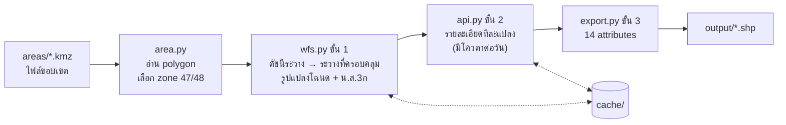

# LandsMaps Parcels — ดึงแปลงที่ดินตามขอบเขตพื้นที่

วางไฟล์ขอบเขตพื้นที่ (KMZ / KML / SHP / GPKG / GeoJSON / GDB) แล้วรันคำสั่งเดียว
ได้ **Shapefile แปลงโฉนดและ น.ส.3ก ทุกแปลงในพื้นที่** จาก [LandsMaps กรมที่ดิน](https://landsmaps.dol.go.th/)
พร้อมเลขที่ดิน ระวาง ประเภท ไร่-งาน-วา และภาระผูกพัน เปิดใน QGIS / ArcGIS ได้ทันที

```
areas/my_site.kmz  ──►  python fetch_parcels.py  ──►  output/my_site/my_site_parcel_epsg24047.shp
                                                       output/my_site/my_site_ns3k_epsg24047.shp
```

- ใช้ได้ทั้งประเทศ (UTM zone 47 และ 48 ตรวจให้อัตโนมัติ)
- ไม่ต้องแก้ code ไม่ต้องรู้เลขระวาง
- หยุดกลางทางแล้วรันใหม่ได้ จะทำต่อจากที่ค้างไว้

---

## Workspace

```
landsmaps-parcels/
│
├── areas/                  ◄── ① วางไฟล์ขอบเขตพื้นที่ของคุณที่นี่
│   └── my_site.kmz             (ชื่อไฟล์ = ชื่อโฟลเดอร์/ไฟล์ผลลัพธ์)
│
├── fetch_parcels.py        ◄── ② รันไฟล์นี้: ดึงแปลงทุกพื้นที่ใน areas/
├── search_parcel.py            (เสริม) ค้นแปลงจากเลขโฉนด
├── Access_Key.txt              (ไม่บังคับ) access token ของบัญชี LandsMaps — ห้ามแชร์
│
├── output/                 ◄── ③ ผลลัพธ์ (สร้างให้อัตโนมัติ)
│   ├── my_site/
│   │   ├── my_site_parcel_epsg24047.shp    โฉนดที่ดิน
│   │   └── my_site_ns3k_epsg24047.shp      น.ส.3ก
│   └── search/
│       └── parcel_search_epsg24047.shp     ผลจาก search_parcel.py
│
├── cache/                      ข้อมูลดิบที่ดึงมาแล้ว (ทำให้รันซ้ำ/ทำต่อได้ ไม่ต้องดึงใหม่)
│   ├── my_site_detail.jsonl        รายละเอียดรายแปลง — อย่าลบ ใช้โควตาไปแล้ว
│   └── parcel_53394_my_site.json   รูปแปลงจาก WFS — ลบได้ ดึงใหม่ฟรี
│
├── landsmaps/                  ตัว code (ไม่ต้องแก้)
│   ├── config.py                   ค่าตั้งต้น: โฟลเดอร์, หน่วงเวลา, ชื่อ field
│   ├── area.py                     อ่านไฟล์ขอบเขต -> polygon + เลือก zone
│   ├── zones.py                    zone 47/48: ชื่อ layer, EPSG, การแปลงพิกัด
│   ├── wfs.py                      ขั้น 1: หาระวาง + รูปแปลงจาก WFS
│   ├── api.py                      ขั้น 2: รายละเอียดรายแปลง + token + cache
│   ├── export.py                   ขั้น 3: จัด 14 attributes -> Shapefile
│   └── pipeline.py                 รวม 3 ขั้นสำหรับ 1 พื้นที่
│
├── notebook/fetch_parcels.ipynb    ทางเลือกสำหรับคนที่ใช้ Jupyter
├── examples/sample_area.geojson    พื้นที่ตัวอย่างเล็ก ๆ ไว้ลองรัน
├── tests/                          ชุดทดสอบ (pytest)
└── requirements.txt
```

`areas/`, `output/`, `cache/` และ `Access_Key.txt` อยู่ใน `.gitignore` แล้ว ข้อมูลพื้นที่และ token ของคุณจะไม่ถูก commit ขึ้น git

---

## เริ่มใช้งาน

### 1. ติดตั้ง (ครั้งเดียว)

ต้องมี Python 3.10 ขึ้นไป

```bash
pip install -r requirements.txt
```

> ถ้าใช้ Anaconda: `conda install -c conda-forge geopandas pyogrio requests` ก็พอ

### 2. วางไฟล์ขอบเขต

คัดลอกไฟล์พื้นที่ไปไว้ใน `areas/` วางได้หลายไฟล์ ไฟล์ละพื้นที่

| รูปแบบ | หมายเหตุ |
|---|---|
| `.kmz` / `.kml` | วาดจาก Google Earth / My Maps ได้เลย |
| `.shp` | ต้องมี `.shx` `.dbf` `.prj` อยู่ด้วย |
| `.gpkg`, `.geojson` | |
| โฟลเดอร์ `.gdb` | File Geodatabase ของ ArcGIS |

- ต้องเป็น **รูปปิด (polygon)** ถ้ามีจุด/เส้นปนมาจะข้ามให้เอง ถ้ามีหลาย polygon จะรวมเป็นพื้นที่เดียว
- พิกัดระบบไหนก็ได้ ถ้ามีข้อมูล CRS (`.prj`) จะแปลงให้เอง
- ชื่อไฟล์จะใช้เป็นชื่อผลลัพธ์ เช่น `Site A.kmz` → `output/site_a/`

### 3. รัน

```bash
python fetch_parcels.py
```

ตัวอย่างผลที่จอ:

```
[sample_area] 0.43 ตร.กม.  zone 48  bbox (104.8, 15.2, 104.806, 15.206)
  ระวาง: 59392
  parcel ระวาง 59392: 75 แปลงใน bbox
  parcel: 73 แปลงแตะกรอบ (ครอบคลุม 65% ของพื้นที่)
  ns3k ระวาง 5939: 0 แปลงใน bbox
  ns3k: 0 แปลงแตะกรอบ (ครอบคลุม 0% ของพื้นที่)
  LandsMaps: ไม่ล็อกอิน (ค้นรายละเอียดได้ประมาณ 20-40 แปลง/วัน)
  รายละเอียด: มี cache 0 แปลง  เหลือ 73 แปลง
  หยุด: LandsMaps แจ้ง [เกินจำกัด 20 /วัน ...] -> ดึงได้ 31 แปลงในรอบนี้ ...
  -> output/sample_area/sample_area_parcel_epsg24048.shp: 73 แปลง (ยังไม่มีรายละเอียด 42)
  -> sample_area_ns3k_epsg24048.shp: ไม่มีแปลง (ไม่สร้างไฟล์)
```

ถ้ายังไม่มีไฟล์ของตัวเอง ลองกับพื้นที่ตัวอย่างก่อนได้ (`--no-detail` = ไม่ใช้โควตา):

```bash
python fetch_parcels.py examples/sample_area.geojson --no-detail
```

### 4. เปิดใน QGIS

ลาก `.shp` จาก `output/` เข้า QGIS ได้เลย ผลลัพธ์ใช้ CRS ดั้งเดิมของกรมที่ดิน

| พื้นที่ | CRS |
|---|---|
| ตะวันตกของ 102°E (ส่วนใหญ่ของประเทศ) | EPSG:24047 Indian 1975 / UTM 47N |
| ตั้งแต่ 102°E ไปทางตะวันออก (อีสานตะวันออก ตะวันออกบางส่วน) | EPSG:24048 Indian 1975 / UTM 48N |

ตั้ง Project CRS ให้ตรงกับไฟล์ แล้วแปลงจะซ้อนกับ WMS ของกรมที่ดินได้ตรง

---

## ตัวเลือกคำสั่ง

```bash
python fetch_parcels.py                            # ทุกไฟล์ใน areas/
python fetch_parcels.py areas/a.kmz areas/b.shp    # เฉพาะไฟล์ที่ระบุ (อยู่ที่ไหนก็ได้)
python fetch_parcels.py --no-detail                # แค่รูปแปลง + เลขที่ดิน ไม่ใช้โควตา
python fetch_parcels.py site.gdb --layer Polygons  # เลือก layer (ไม่ระบุ = รวม polygon ทุก layer)
python fetch_parcels.py "พื้นที่ใหม่.kmz" --name site2   # ตั้งชื่อผลลัพธ์เอง
```

### ค้นจากเลขโฉนด

```bash
python search_parcel.py --prov 36 --amphur 07 30219 30220
```

`--prov` = รหัสจังหวัด 2 หลัก, `--amphur` = รหัสอำเภอ 2 หลัก (ดูได้จากหน้าค้นหาแปลงในเว็บ LandsMaps)
ผลลัพธ์อยู่ที่ `output/search/` วิธีนี้ได้ **เลขโฉนดเต็ม** (ค้นจากตำแหน่งจะได้แบบซ่อน `xxxx19`)

### Jupyter

เปิด `notebook/fetch_parcels.ipynb` แก้ `AREA_FILE` (หรือปล่อย `None` = ทุกไฟล์ใน `areas/`) แล้ว Run All

---

## โควตาและ Access Token

LandsMaps จำกัดจำนวน **การค้นรายละเอียดแปลงต่อวัน** (รูปแปลงจาก WFS ไม่จำกัด)

| แบบ | ค้นรายละเอียดได้ต่อวัน (โดยประมาณ) |
|---|---|
| ไม่ล็อกอิน | ~20 – 40 แปลง |
| ล็อกอิน (ใส่ access token) | ~200 – 400 แปลง |

> ตัวเลขนี้มาจากการใช้งานจริง ไม่ใช่ตัวเลขทางการ เว็บจะแจ้งว่า "เกินจำกัด 20 /วัน หรือ 200 /วัน เมื่อทำการล็อกอิน" แต่จำนวนที่ดึงได้จริงมักมากกว่านั้นและไม่เท่ากันทุกวัน กรมที่ดินอาจเปลี่ยนเงื่อนไขได้ทุกเมื่อ

- **ไม่มี token** → เมื่อโควตาเต็มโปรแกรมจะหยุดเองแล้วบันทึก Shapefile ให้ (แปลงที่ยังไม่ได้ดึงมี Remark = `ยังไม่ได้ดึงรายละเอียด`) รันซ้ำวันถัดไปจะทำต่อจาก cache
- **มีบัญชี LandsMaps** (ลงทะเบียนกับกรมที่ดิน) → ดึงได้มากขึ้นราว 10 เท่า โดยใส่ access token ของบัญชี:
  1. ล็อกอิน https://landsmaps.dol.go.th/ ด้วย Chrome/Edge
  2. กด `F12` → แท็บ **Application** → **Session Storage** → `https://landsmaps.dol.go.th` → `userinfo`
  3. คัดลอกค่า `access_token`
  4. วางลงไฟล์ `Access_Key.txt` ที่โฟลเดอร์หลัก (หรือตั้ง environment variable `LANDSMAPS_TOKEN`)

  token มีอายุ **24 ชั่วโมง** หมดแล้วโปรแกรมจะแจ้งให้คัดลอกใหม่

> ⚠️ token มีข้อมูลบัญชีและเลขประจำตัวของคุณอยู่ข้างใน **ห้ามส่งต่อหรือ commit ขึ้น git**

ถ้ามีหลายพื้นที่แล้วโควตาเต็มระหว่างทาง พื้นที่ถัดไปจะดึงแค่รูปแปลง (ไม่เสียเวลาลองต่อ)

---

## ข้อมูลในไฟล์ผลลัพธ์

| Field | ความหมาย | ที่มา |
|---|---|---|
| `Owner_Name` | ชื่อเจ้าของ | เว้นว่าง — LandsMaps ไม่เปิดเผย |
| `Surname` | นามสกุล | เว้นว่าง — LandsMaps ไม่เปิดเผย |
| `Contact_No` | เบอร์ติดต่อ | เว้นว่าง — LandsMaps ไม่เปิดเผย |
| `Type_land` | ประเภทเอกสารสิทธิ์ (โฉนดที่ดิน / น.ส.3ก) | API |
| `Rawang` | ระวาง เช่น `5339 IV 7808-00` | API |
| `Group` | กลุ่ม | เว้นว่างไว้ให้กรอกเอง |
| `Plang` | เลขที่ดิน | WFS |
| `Cert_No` | เลขโฉนด (ค้นจากตำแหน่งจะเห็น 2 หลักท้าย เช่น `xxxx19`) | API |
| `Rai` `Ngan` `Wa` | เนื้อที่ตามเอกสารสิทธิ์ | API |
| `Status` | ภาระผูกพัน เช่น `obligation:จำนอง` | API |
| `LLA_no` | | เว้นว่างไว้ให้กรอกเอง |
| `Remark` | ว่าง = ครบ / `ยังไม่ได้ดึงรายละเอียด` / `ไม่พบรายละเอียดใน LandsMaps` / `ตำแหน่งชี้ไปแปลงอื่น` | |

ไฟล์ `*_ns3k_*` (น.ส.3ก) มีแค่รูปแปลงและเลขที่ดิน เพราะ LandsMaps ไม่มี API รายละเอียดของ น.ส.3ก จากตำแหน่ง

ถ้าต้องการเปลี่ยนชื่อ/ลำดับ field แก้ `FIELDS` ใน [landsmaps/config.py](landsmaps/config.py)

---

## ทำงานอย่างไร



1. **อ่านขอบเขต** รวม polygon ทั้งหมดในไฟล์ แปลงพิกัดด้วยสูตรเดียวกับที่ GeoServer ของกรมที่ดินใช้ (Indian 1975 → WGS84) แปลงจึงซ้อนตรง
2. **รูปแปลง (WFS)** หาระวาง 1:50,000 ที่ครอบคลุมจากดัชนีระวาง แล้วดึงรูปแปลงเฉพาะใน bbox คัดเฉพาะแปลงที่แตะขอบเขต ขั้นนี้ไม่จำกัดจำนวน ไม่ต้องล็อกอิน
3. **รายละเอียด (API)** ถามข้อมูลที่จุดกลางแปลงทีละแปลง หน่วง 1 วินาที/แปลงเพื่อไม่ให้โหลดเซิร์ฟเวอร์กรมที่ดิน บันทึกลง `cache/<ชื่อ>_detail.jsonl` ทันทีทุกแปลง
4. **Shapefile** รวมรูปแปลง + รายละเอียด ตามลำดับ field ที่กำหนด

---

## ข้อจำกัด

- ข้อมูลเจ้าของ (ชื่อ นามสกุล เบอร์) **ไม่มี** ใน LandsMaps แบบสาธารณะ
- ที่ดินที่ไม่อยู่ในระบบกรมที่ดิน (ส.ป.ก., ป่าสงวน, ที่สาธารณะ ฯลฯ) จะไม่มีแปลง ตัวเลข "ครอบคลุม xx% ของพื้นที่" ช่วยบอกว่าเหลือช่องว่างเท่าไร
- พื้นที่คร่อมเส้น 102°E จะใช้ zone ของจุดศูนย์กลาง ส่วนที่อยู่อีก zone จะหายไป → แยกเป็น 2 ไฟล์ (โปรแกรมจะเตือน)
- WFS ให้ได้สูงสุด 60,000 แปลงต่อระวางต่อครั้ง ถ้าเกินโปรแกรมจะแจ้ง → แบ่งพื้นที่ให้เล็กลง
- เนื้อที่จากรูปแปลงเป็นค่าประมาณ ให้ใช้ ไร่-งาน-วา ตามเอกสารสิทธิ์เป็นหลัก
- ระบบ LandsMaps อาจเปลี่ยน API ได้โดยไม่แจ้ง

---

## Cache และการรันซ้ำ

| ไฟล์ | เก็บอะไร | ลบได้ไหม |
|---|---|---|
| `cache/<ชื่อ>_detail.jsonl` | รายละเอียดรายแปลงที่ดึงแล้ว | **ไม่ควร** — ใช้โควตาไปแล้ว ลบแล้วต้องดึงใหม่ |
| `cache/parcel_<ระวาง>_<ชื่อ>.json`<br/>`cache/ns3k_<ระวาง>_<ชื่อ>.json` | รูปแปลงจาก WFS | ได้ — ดึงใหม่ฟรี (ถ้าแก้ขอบเขต ระบบจะดึงใหม่ให้เอง) |
| `output/` | Shapefile ผลลัพธ์ | ได้ — รันใหม่จะสร้างจาก cache ทันที |

cache ผูกกับ **ชื่อไฟล์ขอบเขต** ถ้าเปลี่ยนชื่อไฟล์ จะเริ่มนับรายละเอียดใหม่ (ใช้ `--name ชื่อเดิม` เพื่อใช้ cache เดิม)

---

## แก้ปัญหา

| อาการ | สาเหตุ / วิธีแก้ |
|---|---|
| `ไม่พบไฟล์ขอบเขต` | ยังไม่ได้วางไฟล์ใน `areas/` หรือนามสกุลไม่รองรับ |
| `ไม่พบ polygon` | ไฟล์มีแต่จุด/เส้น ต้องวาดเป็นรูปปิด |
| `ไม่มีข้อมูล CRS ... และพิกัดไม่ใช่ lon/lat` | Shapefile ขาด `.prj` → กำหนด CRS ใน QGIS แล้ว export ใหม่ |
| `ไม่พบระวางในกรอบนี้` | พื้นที่อยู่นอกประเทศไทย หรือพิกัดผิด (lat/lon สลับกัน) |
| `access token หมดอายุแล้ว` | token อายุ 24 ชม. → คัดลอกใหม่ใส่ `Access_Key.txt` (หรือลบไฟล์เพื่อใช้แบบไม่ล็อกอิน) |
| `เกินจำกัด 20 /วัน` | โควตาวันนี้หมด (ตัวเลขในข้อความไม่ตรงกับที่ดึงได้จริง ดู [โควตา](#โควตาและ-access-token)) → รันใหม่พรุ่งนี้ หรือใช้ token ของบัญชี |
| แปลงไม่ครบตามที่เห็นในเว็บ | ดูตัวเลข "ครอบคลุม xx%" ถ้าต่ำ อาจเป็นที่ดินนอกระบบกรมที่ดิน |
| ภาษาไทยใน attribute เพี้ยนใน ArcMap | ไฟล์เป็น UTF-8 (มี `.cpg`) ArcMap รุ่นเก่าต้องตั้งค่า code page เอง |

---

## สำหรับนักพัฒนา

```bash
python -m pytest tests          # ทดสอบแบบ offline ทั้งหมด ไม่เรียกเซิร์ฟเวอร์จริง
```

ใช้เป็น library ได้:

```python
from landsmaps import run_area

result = run_area("areas/my_site.kmz", fetch_detail=False)
print(result.parcel_file, result.n_parcel)
```

ค่าที่ปรับได้อยู่ใน [landsmaps/config.py](landsmaps/config.py) เช่น `SLEEP_SEC` (หน่วงระหว่างคำขอ — กรุณาอย่าตั้งต่ำกว่า 1 วินาที)

---

## ข้อควรทราบเรื่องการใช้ข้อมูล

- ข้อมูลทั้งหมดเป็นของ **กรมที่ดิน** ดึงจากบริการสาธารณะของ LandsMaps ตามสิทธิ์ของผู้ใช้แต่ละคน
- เครื่องมือนี้ไม่ได้หลบเลี่ยงโควตาหรือการยืนยันตัวตน และหน่วงเวลาระหว่างคำขอเพื่อไม่ให้รบกวนระบบ
- ผลลัพธ์ใช้ประกอบการวางแผน/สำรวจเบื้องต้นเท่านั้น **ไม่ใช่เอกสารทางกฎหมาย** ตรวจสอบกับสำนักงานที่ดินก่อนใช้อ้างอิงเสมอ
- โปรดใช้ข้อมูลตามกฎหมายคุ้มครองข้อมูลส่วนบุคคล (PDPA) และเงื่อนไขการใช้งานของกรมที่ดิน
